# Implementation plan (Gantt)

Generated by `/forge:kanban decompose` on 2026-10-24 from `meta/architecture/handoff.md`.
Every card carries a cycles-only estimate (ADR-0055), so every bar is the nominal 1d slot,
not a day estimate. Gantt durations: 0 of 3 cards carry a days term.

```mermaid
gantt
  title Implementation plan
  dateFormat X
  axisFormat Slot %j
  %% Gantt durations — 0 of 3 cards carry a days term, every bar is the nominal 1d bar, not an estimate
  section Wave 1 (no deps)
    CARD-001 P1 Moves under concurrency, end to end (walking skeleton) :crit, card1, 0, 1d
  section Wave 2
    CARD-002 P1 Card editing and the full API contract :crit, card2, after card1, 1d
  section Wave 3
    CARD-003 P2 The board page and the browser check :card3, after card2, 1d
```

